# Tondo user manual

Everything the firmware can do on the round **Waveshare ESP32‑P4‑WIFI6‑Touch‑LCD‑3.4C**,
screen by screen and setting by setting. For flashing and first‑time pairing,
start with the [README](README.md#getting-started).

The screen is a circle. The clock and WiFi status sit at the top, and a
row of three buttons at the bottom switches between **Home**, **Settings** and
**Stats**. Settings pages have a round **back** button beside their title.

**Contents:**

- [Where everything lives](#nav-map) — a map of every screen and setting
- [Home](#home) — the idle view · temperature dial · steam sheet · during a
  shot · shot modes
- [Settings → Micra](#settings-micra) — Bluetooth · Controls · Cleaning
- [Settings → Scale](#settings-scale) — Bluetooth · Shot settings (→ Graph) ·
  Device settings · Per‑scale nuances
- [Settings → Tondo](#settings-device) — Display · Sound · Time & date · WiFi ·
  Backup · Root page
- [Stats](#stats-section) — Brew/Steam history · History · Info
- [Brew‑by‑weight quick reference](#bbw-reference)

---

<a id="nav-map"></a>

## Where everything lives

<!-- Keep this map in sync with the UI: when a setting/page is added, moved,
     or renamed, update the tree below (and the prose sections). -->

Every screen and setting, and how to reach it:

```
Home
├─ Status · brew temperature (tap → temperature dial) · brew/steam arcs
├─ [Steam capsule]   tap → steam sheet (On/Off · three levels)
├─ [Weight capsule]  live scale weight                     (scale paired)
├─ [Standby]  Standby / Turn on / Connect / Set up
├─ [Flush]    quick group rinse                            (Wired paddle on)
├─ [Tare]                                                  (scale paired)
├─ [shot-mode pill]  Auto shot → Shot detect → Manual       (scale paired)
└─ During a shot: progress ring · weight · timer + target · flow graph
   (g/s ↔ g) · Reset

Settings
├─ Micra
│  ├─ Bluetooth — saved machine (Setup / Connect / Forget) · Auto connect · Scan
│  ├─ Controls  — Wired paddle · Brew temperature → dial · Steam boiler → sheet
│  └─ Cleaning  — Auto flush · Flush delay · Backflush cleaning → cleaning mode
├─ Scale
│  ├─ Bluetooth       — saved scale (Connect / Forget) · Scan
│  ├─ Shot settings   — Target · Review hold · Detect lead-in
│  │  └─ Graph        — Smoothing · Drop negative g/s · Window growth
│  └─ Device settings — the scale's own settings (Beep · Auto-off/sleep · Unit …)
├─ Tondo
│  ├─ Display     — Brightness · Screen timeout
│  │               · Idle screen (Lion/Apollo/Alternate/Dim/Off/Clock) · Fahrenheit
│  ├─ Sound       — Chime melody · Chime volume · Button sounds
│  ├─ Time & date — Time · Date (until Auto time sets them) · 24-hour · Timezone
│  ├─ WiFi        — Enable · Status · Set up WiFi → QR portal · Forget
│  │               · Auto time (NTP) · Check for updates (Off/Boot/Daily/Hourly)
│  │                 → notice → Install now · Beta updates
│  └─ Backup      — On the card · Back up to card · Restore from card
└─ Lock display for cleaning  → 30 s touch lock

Stats
├─ Brew | Steam — temperature history chart (−/+ time window)
├─ History — headline stats (tap → reset) · shot list · web address + card space
│            └─ tap a shot → full-screen shot card (with delete)
└─ Info — firmware (Check for updates; long-press → performance overlay) · uptime
          · IP · NTP synced · Diagnostic log (tap → viewer) · Micra details
```

---

## Home

Home has two faces. Most of the time it shows the machine, as below. While a
shot runs (with a scale paired) it switches to the
[shot view](#during-a-shot). Without a scale, the scale parts simply aren't
there:

<p align="center">
  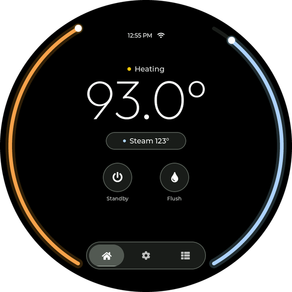
</p>

### The idle view

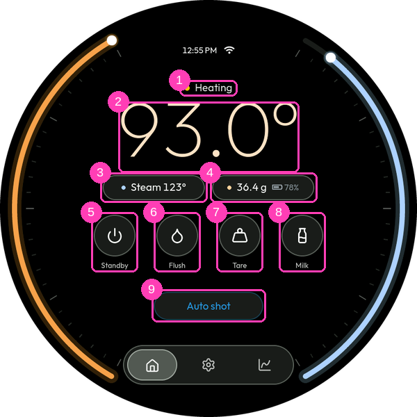

The two **arcs** around the edge are the boilers: brew on the left (amber),
steam on the right (blue). Each fills from room temperature towards its
set‑point and is full when the boiler has arrived. Both are empty while the
machine is disconnected, and the steam arc is empty while steam is off.

- ① **Status** — `Not set up` (no machine chosen yet), `Setup unfinished`
  (a machine is chosen but pairing never completed — in both of these the
  Standby button reads **Set up** and takes you straight to Settings > Micra >
  Bluetooth), `Disconnected`, `Connecting...`, `Heating` (powered on, boilers
  still coming up to temperature — the dot pulses amber), `Ready` (at
  temperature), or `Standby`. The Micra itself doesn't report a warm‑up state;
  `Heating` is inferred from the live boiler temperatures vs their set‑points.
  A boiler within **2 °C** of its set‑point counts as ready, because the
  machine's own thermostat works to about that tolerance — a steam boiler set
  to 128 °C routinely settles at 127 °C and stops heating there. Tondo can
  also chime when it turns `Ready` — see [Settings → Tondo → Sound](#sound).
- ② **Brew temperature** — the live coffee‑boiler temperature. **Tap it** to
  open the [temperature dial](#dial) and change the set‑point.
- ③ **Steam** — the live steam‑boiler temperature (or `Steam off`). **Tap it**
  for the [steam sheet](#steam-sheet): on/off and the three steam levels.
- ④ **Weight** *(scale paired)* — the scale's live reading, or `Scale off` when
  it isn't connected. Connect and disconnect the scale under
  [Settings → Scale → Bluetooth](#scale-bluetooth).
- ⑤ **Standby** — `Standby` / `Turn on` when connected. After a tap it briefly
  reads `Working...` (disabled) until the machine reports the change — the
  Micra's answer trails the command by a couple of seconds, and the button
  would otherwise look like it did nothing. When the machine is configured but
  disconnected it becomes **Connect** and starts the Bluetooth link.
- ⑥ **Flush** *(with **Wired paddle** on)* — runs the group for a quick rinse,
  for the same time as **Auto flush** (3 s when Auto flush is Off). While it
  runs it becomes **Stop**; tap to stop early. Greyed out while a shot is in
  flight or the machine is in standby.
- ⑦ **Tare** *(scale paired)* — zeroes the scale. (Tares are sent twice under
  the hood; some scales drop single tare commands.)
- ⑧ **Shot mode pill** *(scale paired)* — tap to cycle the shot mode:
  - **Auto shot** *(only with a wired paddle — see below)*: flipping the
    Micra's paddle starts the shot (auto‑tare, timer, graph), and the firmware
    opens the paddle circuit by itself when the weight reaches
    *target − overshoot*. The overshoot compensation is learned from each
    auto‑stopped shot's settled weight, so accuracy improves over the first
    few shots.
  - **Shot detect**: no wiring needed — the shot is detected from the weight
    stream alone (start when flow sustains, stop when flow ceases). There is
    no auto‑stop; instead the pill flashes **Stop** when the shot reaches the
    point where the auto‑stop would have fired, telling you to flip the
    paddle now. Detection confirms a few seconds after the first drip; the
    moment it does, the timer, weight and graph snap to the full shot —
    back‑dated to the estimated start, including the **Detect lead‑in**
    (see **Settings → Scale → Shot settings**).
  - **Manual**: nothing armed. A wired paddle still relays the paddle and
    times the shot; otherwise the scale's own timer is shown.
  - While a finished shot is frozen for review the pill reads **Reset** —
    tap it to dismiss the review and return to live monitoring.
  - The pill is disabled while a shot is running or settling.
- Like the shot‑mode pill, **Tare** is disabled while a shot is running or
  settling — it would disturb the weight the stop math runs on. It re‑enables
  the moment the shot is over, however it ends.

<a id="dial"></a>

### Temperature dial

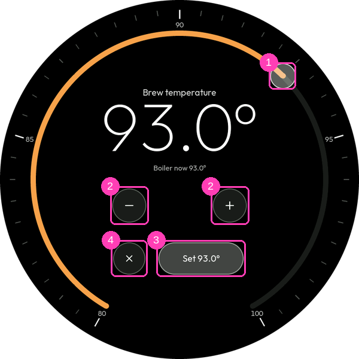

Opened by tapping the brew temperature on Home (or **Settings → Micra →
Controls → Brew temperature**). The big number is the set‑point you're
choosing; the small line under it is the boiler's live temperature.

- ① **Drag the knob** round the ring to pick a set‑point between 80 and
  100 °C, in 0.5 °C steps.
- ② **−** / **+** nudge it by 0.5 °C.
- ③ **Set** writes the new set‑point to the machine and closes the dial.
- ④ **✕** closes without changing anything.

<a id="steam-sheet"></a>

### Steam sheet

<p align="center">
  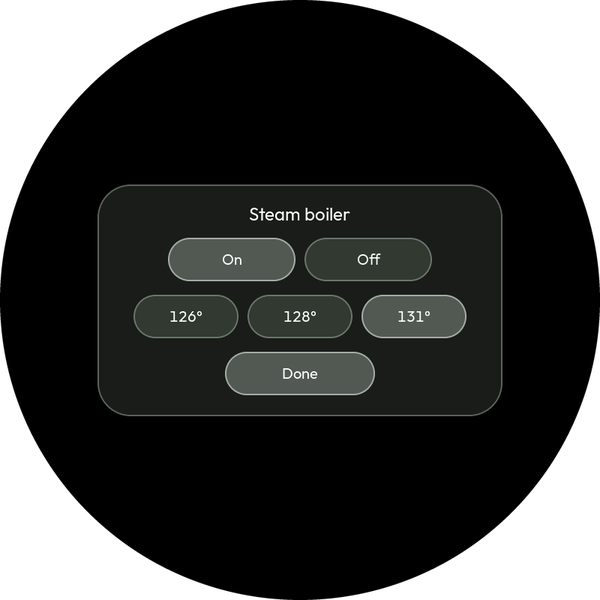
</p>

Opened by tapping the steam capsule on Home (or **Settings → Micra → Controls
→ Steam boiler**). **On** / **Off** switches the steam boiler; the three
buttons below are the Micra's three steam levels (126, 128 and 131 °C). Each
tap goes to the machine straight away. **Done** — or a tap outside the
sheet — closes it.

<a id="during-a-shot"></a>

### During a shot

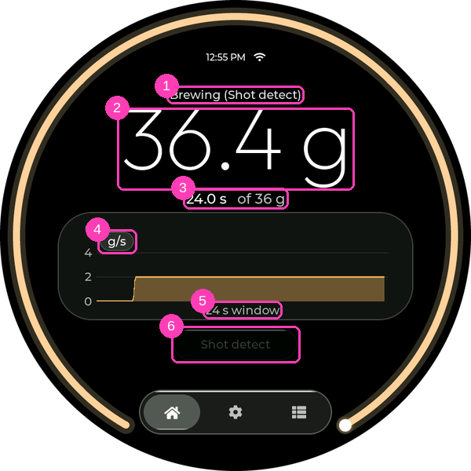

When a shot starts, Home switches to the shot view. The two boiler arcs give
way to one **progress ring** that fills as the weight climbs towards the
target. It switches back once the review ends.

- ① **What's happening** — `Brewing (Auto shot)` (or Shot detect / Manual),
  `Finishing` while the drips settle, then `Shot complete` while the result is
  up for review.
- ② **Weight** — the shot's weight. During review it freezes at the net shot
  weight, so lifting the cup doesn't wipe the number you care about.
- ③ **Timer** and **target** — the shot timer runs from Tondo's own clock
  whenever the firmware is the shot authority (Auto shot or Shot detect, and
  every wired shot); in Manual mode without a wire it falls back to the scale's
  built‑in timer. The target is the brew‑by‑weight stop target (**Settings →
  Scale → Shot settings → Target**).
- ④ **g/s** — tap to switch the graph between flow rate (g/s) and weight (g).
- ⑤ **Window** — the time span in view. The graph starts with the shot and
  widens as the shot runs on (see **Window growth**); when the shot ends it
  freezes for review (see **Review hold**).
- ⑥ **Shot pill** — disabled while the shot runs, then **Reset** during the
  review: tap it to go back to the idle view early.

### Shot lifecycle notes (all modes)

- A run shorter than **8 seconds** never becomes a "shot" — it's treated as a
  flush/rinse and discarded silently. Shot detect additionally requires a few
  grams of net gain.
- **Auto shot and Shot detect refuse to start without the scale.** Flipping
  the paddle while the scale isn't connected leaves the machine off and pops a
  message — connect the scale (or wake it) or switch to **Manual** mode. This
  catches the "flipped the paddle, then noticed the scale was never set up"
  shot. Waking a standby machine with a paddle flip still works (no water
  moves), and deliberate untracked runs remain available via Manual mode or
  the **Flush** button.
- With a wired paddle, flipping the paddle ON **while a review is frozen** is
  swallowed (the machine does not start) and the **Reset** pill flashes —
  dismiss the review first, then start the next shot. This prevents an
  expected auto shot from silently running as a manual one.

---

<a id="settings-micra"></a>

## Settings → Micra

### Bluetooth (machine)

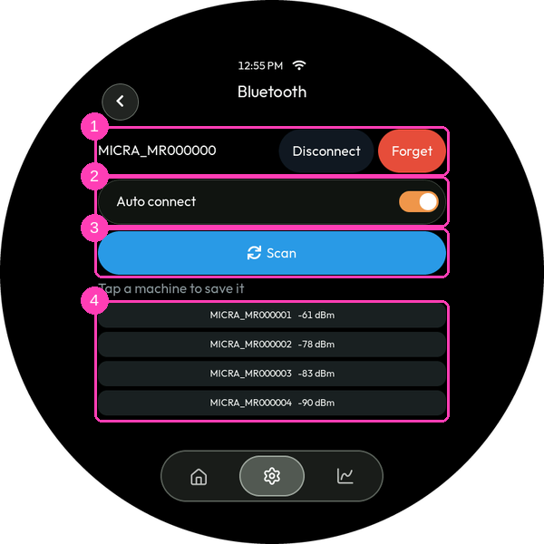

- ① **Saved machine row** — shows the paired machine with:
  - **Setup** (only until a token is stored) — starts the token entry flow
    (see the [README](README.md#4-enter-your-token)):

    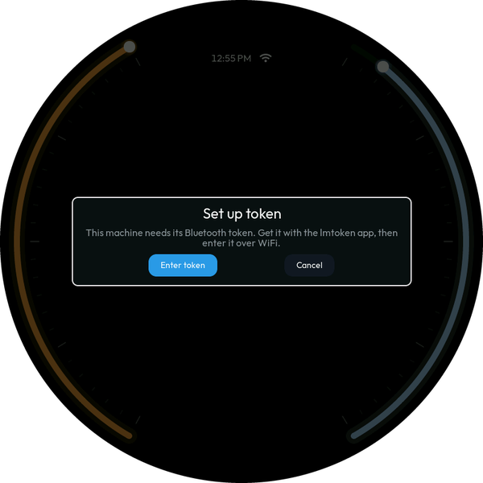

  - **Connect / Disconnect** — manual link control. The Micra accepts only one
    Bluetooth client, so Disconnect frees it for another remote or the phone
    app.
  - **Forget** — clears the machine, its name, and its token.
- ② **Auto connect** *(default on)* — connect to the saved machine automatically
  at power‑up. Turn off if another controller needs the Micra's single
  Bluetooth slot.
- ③ **Scan** — searches for La Marzocco machines; found machines list below ④,
  tap one to save it. Scanning takes priority over in‑progress background
  connections (a scale stuck in `Connecting...` no longer blocks it). If
  nothing is found the status line says so — make sure the machine is powered
  on and in range, then scan again.

### Controls

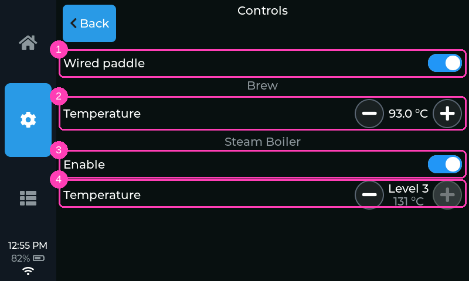

- ① **Wired paddle** *(default off)* — tell the firmware the paddle harness is
  physically wired (see the [wiring guide](docs/WIRING.md)). This enables the
  **Auto shot** mode, the **Flush** button and the auto‑flush. Off, Tondo
  behaves like an unwired remote (Shot detect / Manual only). Flipping it
  mid‑shot cancels the shot.
- ② **Brew temperature** — the coffee boiler's set‑point; tap to open the
  [temperature dial](#dial).
- ③ **Steam boiler** — the current steam level (or Off); tap to open the
  [steam sheet](#steam-sheet).

### Cleaning

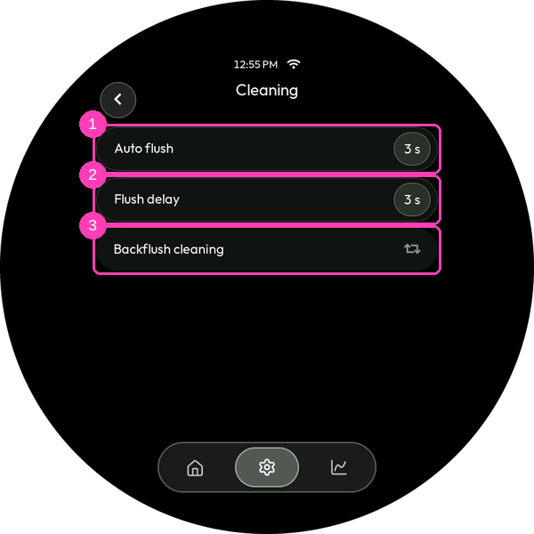

Everything that deliberately runs water through the group. The whole page
needs the paddle harness, since that's what drives it.

- ① **Auto flush** *(Off / 3 / 6 / 9 / 15 s; default Off)* — after a finished
  shot, when the scale sees the cup lift off, the firmware waits (see **Flush
  delay**) and then runs the group for this long to rinse the puck's surface.
  Any paddle activity, a new shot, or the machine being in standby cancels it.
  **This one duration drives every timed group run**: the auto‑flush, the Home
  **Flush** button, and each backflush pulse. With Auto flush Off the other two
  fall back to 3 s.
- ② **Flush delay** *(shown while Auto flush is on; 3 / 6 / 9 / 15 s; default
  3 s)* — the pause between the cup coming off and the flush running.
- ③ **Backflush cleaning** — opens a full‑screen cleaning mode. Fit the blind
  filter with detergent, tap **Go**, and the device pulses the group **10
  times: ⟨Auto flush⟩ seconds on, 3 seconds off**, showing the cycle count, a
  countdown, and the total up front. **Cancel** stops the sequence and stays on
  the screen so you can run it again; **Back** stops it and leaves. Flipping
  the physical paddle also stops it — you always outrank the automation. When
  it finishes, rinse the basket and run it again with plain water to clear the
  detergent. Greyed out unless the machine is on and no shot is in flight.
  - **Preinfusion/prebrew matters here.** Each pulse starts a fresh brew, so
    the machine preinfuses *every time*. A pulse shorter than your preinfusion
    never engages the pump, so it runs at line pressure only — water still
    flows and it still rinses, just with far less force than a pump‑pressure
    backflush. If that's not what you want, either raise **Auto flush** until
    the pulse comfortably outlasts preinfusion, or turn preinfusion off while
    you backflush.

  <p align="center">
    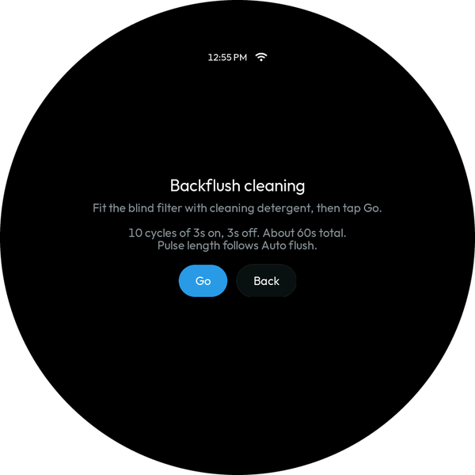
  </p>

---

<a id="settings-scale"></a>

## Settings → Scale

<a id="scale-bluetooth"></a>

### Bluetooth (scale)

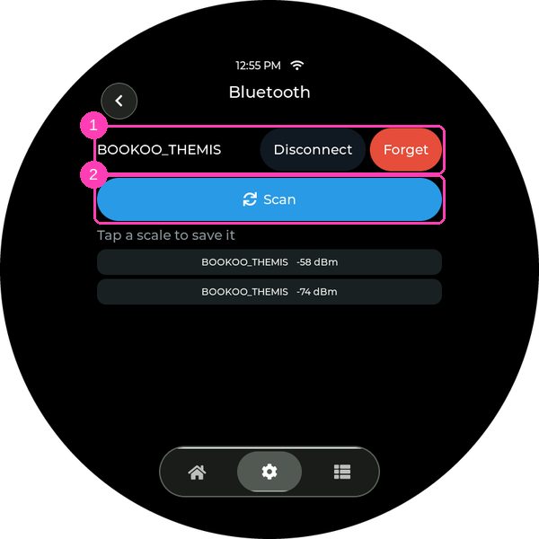

- ① **Saved scale row** — **Connect / Disconnect** and **Forget** (no token
  needed for scales). This is where the scale's link is switched on and off —
  for instance to let it sleep and save its battery.
- ② **Scan** — searches for supported scales (Bookoo Themis, Acaia Umbra /
  Lunar / Prochef / Pyxis, Varia Aku — Pyxis and Aku untested). Wake the scale
  first — most sleep their Bluetooth quickly. Found scales list below; tap one
  to save it.

### Shot settings

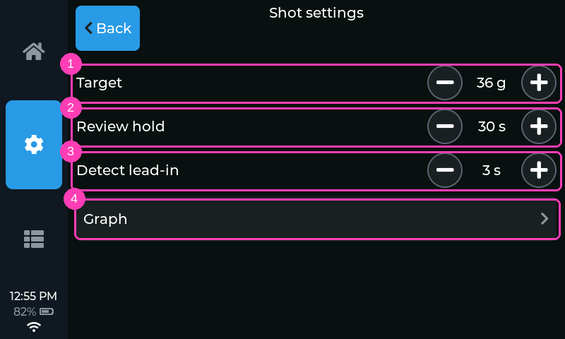

- ① **Target** — brew‑by‑weight stop target, 5–120 g. The shot view shows it
  beside the timer.
- ② **Review hold** *(5–120 s, default 30 s)* — how long a finished shot's frozen
  graph and weight linger before auto‑dismissing. **Reset** dismisses early.
- ③ **Detect lead‑in** *(0–10 s, default 3 s)* — Shot detect mode only. The
  detector notices a shot at the first weight rise, but the shot started
  earlier: you flipped the paddle, then preinfusion water worked through the
  puck before the first drop landed. This offset is added when back‑dating the
  shot start, so the timer and graph line up with the moment you actually
  started the shot. Adjust it to match your machine's preinfusion setting as
  needed (roughly your typical paddle‑to‑first‑drip time); 0 starts the shot
  at the first drip.
- ④ **Graph** — opens the shot graph's display options (below).

<a id="graph"></a>

#### Graph

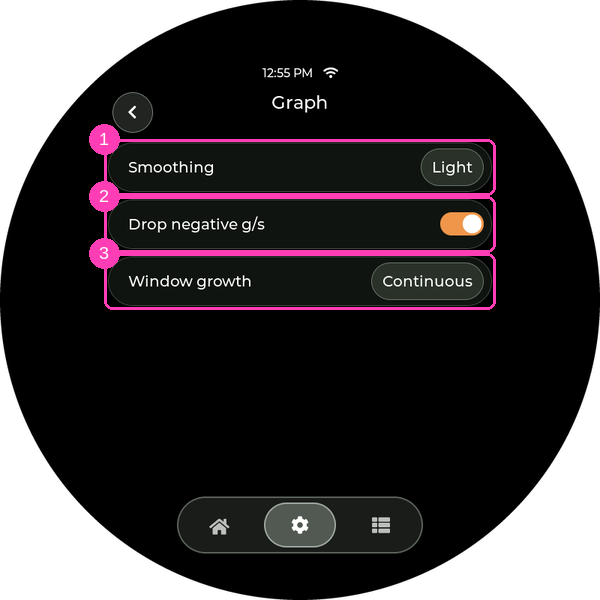

How the flow graph in the shot view draws a shot. All of it is purely visual —
detection, the timer and auto‑stop always use the scale's raw readings.

- ① **Smoothing** *(Off / Light / Medium / Strong, default Light)* — smoothing on
  the shot graph's line.
- ② **Drop negative g/s** *(default on)* — clamps negative flow readings (cup
  bumps, scale noise) to zero on the graph.
- ③ **Window growth** *(Snap / Smooth / Continuous, default Continuous)* — how
  the shot graph's time window widens as a shot runs on past 15 s.
  **Continuous** keeps the whole shot filling the width, squeezing the trace
  as it lengthens. **Snap** jumps to 30, 45 and 60 s instead. **Smooth** makes
  the same jumps but eases each one over a second or so.

### Device settings

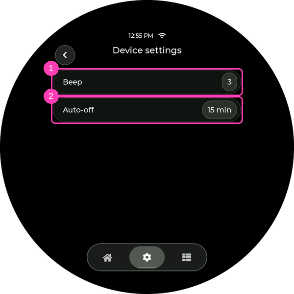

Settings stored on the scale itself, adjusted over Bluetooth. Which rows
appear — and their value choices — depends on the scale model (a Bookoo
Themis's ① **Beep** and ② **Auto‑off** shown above):

- **Bookoo Themis / Themis Ultra** — **Beep** (buzzer level Off / 1–3, the
  same range the Bookoo app offers) and **Auto‑off** (5–30 min). The scale
  also accepts levels 4–5 over Bluetooth, but the firmware plays those
  *quieter* than the real ones, so they aren't offered; one set elsewhere
  shows as `--`.
- **Acaia Umbra** — **Beep** (On / Off; also silences its tare/timer chirps),
  **Auto sleep** (Off / 1–30 min), and **Unit** (g / oz). The Acaia app can
  additionally set *power‑off* timers; those aren't offered here (a
  powered‑off scale can't be woken over Bluetooth) and show as `--` if set
  elsewhere.
- **Acaia Lunar / Pyxis** — **Beep** — the row shows the beep volume the
  scale stores (Off / 1–3), but over Bluetooth the beep can only be toggled:
  tapping cycles **off** and **on**, and *on* restores whatever volume was
  last set with the scale's own buttons (Bluetooth can't set a level — even
  the Acaia app is on/off only). Then **Auto sleep**
  (Off / 5–60 min), **Unit** (g / oz), and **Mode** — the scale's current
  weighing mode, shown for reference only (the Acaia protocol has no way to
  change mode remotely; use the scale's buttons).
- **Varia Aku** — none (no adjustable settings in its protocol; weight and
  battery only).

**Unit** only changes what the *scale's own display* shows — Tondo always
works and displays in grams (an oz‑mode Acaia streams ounces over Bluetooth;
the firmware converts them back, so brew‑by‑weight targets stay correct).
Changed values may take a moment to be confirmed by the scale; if a change
doesn't stick, the row snaps back to what the scale reports.

The scale owns these values: the rows show what it reports, so they read `--`
until the scale is connected (a **Connect** prompt appears right in the group
when it isn't — no scale paired yet, the group points you to Bluetooth
instead). Tap a value to advance to the next choice; the write goes to the
scale immediately and sticks like any change made from the scale's own
buttons. Like Tare, these rows are disabled while a shot is running.

### Per‑scale nuances & recommended daily workflow

The supported scales handle power and sleep differently, so the smoothest
end‑of‑day / morning routine differs by model. In every case, if the Micra has
an auto‑on schedule, the scale step below is the *only* thing you do — the
machine is already warming up when you arrive.

- **Acaia Lunar** — stays running for as long as Bluetooth is connected (it
  won't auto‑sleep on you mid‑connection). Recommended routine: just **power
  the scale off** when you're done and **power it on** in the morning — Tondo
  reconnects to it automatically.
- **Acaia Umbra** — can be used exactly like the Lunar, but it also has a real
  sleep mode that Tondo can wake it from. Recommended routine: tap
  **Disconnect** under **Settings → Scale → Bluetooth** when you're done (the
  Umbra won't sleep *while connected*, so disconnecting is what lets it doze),
  and tap **Connect** there in the morning, which wakes the Umbra over
  Bluetooth. The Umbra's battery lasts about a **week** in sleep mode — and
  once it's flat, Connect naturally can't wake it, so put it on a charger if
  it's been sitting.
- **Bookoo Themis** — has a sleep mode, but it genuinely powers down: Tondo
  **cannot** wake it with Connect. Treat it like the Lunar: leave Tondo
  connecting, **turn the scale on** in the morning and you're good; when
  you're done, just walk away — the scale sleeps on its own from inactivity.

---

<a id="settings-device"></a>

## Settings → Tondo

Short sub‑pages — **Display**, **Sound**, **Time & date**, **WiFi** and
**Backup** — so each page fits on the round screen with little to no
scrolling.

### Display

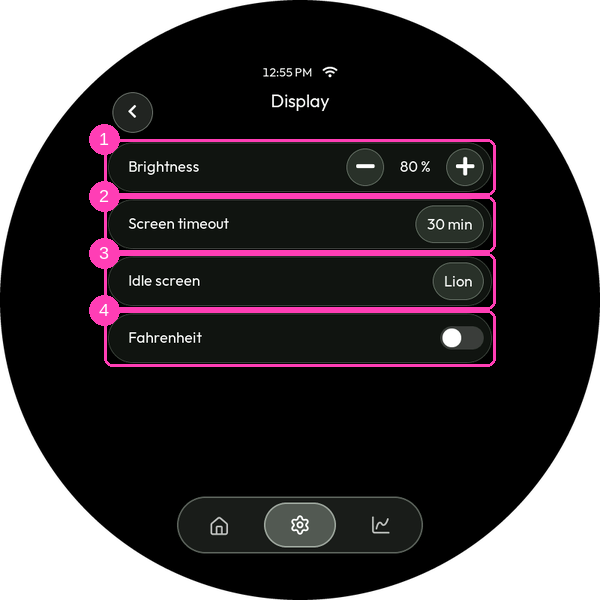

- ① **Brightness** — backlight level.
- ② **Screen timeout** *(Off / 1 / 5 / 15 / 30 min, default 30 min)* — after
  this idle time the idle screen starts (see the next row); any touch wakes the
  screen. A shot in progress never counts as idle, so the idle screen won't
  cover a live shot no matter how short the timeout — the countdown restarts
  when the shot ends.
- ③ **Idle screen** *(Lion / Apollo / Alternate / Dim / Off / Clock, default
  Lion; shown while Screen timeout is on)* — what the timeout shows. **Lion**
  and **Apollo** turn the backlight down to 5 % (low enough to read as asleep,
  high enough that the panel isn't mistaken for switched off) and bounce that
  drawing around a black screen, changing color at every wall it hits — the
  La Marzocco lion, or Apollo sipping an espresso. **Alternate** does the
  same, starting on either one and switching to the other every three
  minutes. **Dim** turns the backlight down the same way but leaves the normal
  screen showing, so you can still glance at the machine from across the
  kitchen. **Off** switches the backlight off entirely. **Clock** is made for
  the round glass: the weekday and time, dimmed the same way, with a small
  glass orb carrying the brew temperature and machine state slowly circling
  the face. Everything on it drifts a little over time so nothing burns into
  the panel.
- ④ **Fahrenheit** *(default off)* — display unit for temperatures. Set‑points
  are still stored in Celsius.

The round display has one colour scheme, made for its glass look, so there is
no **Theme** row. (A theme chosen on Apollo 2 survives a restored backup,
unused here.)

<a id="sound"></a>

### Sound

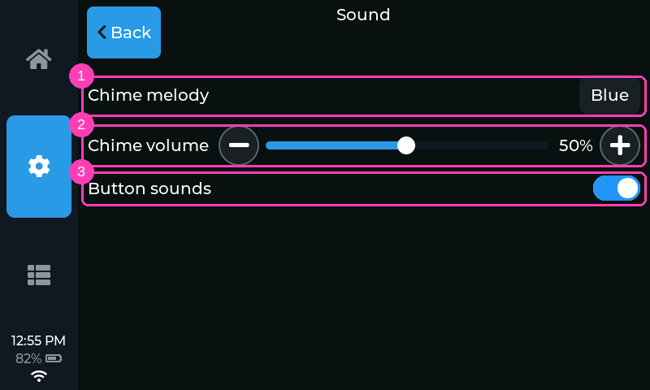

Everything the speaker does, on one page.

- ① **Chime melody** *(Off / Blue / Pink / Human / Gold / White / Autumn /
  Random, default Blue)* — which tune announces the end of a warm‑up. Each tap
  cycles to the next melody and auditions it; **Random** picks a different
  tune each time the machine warms up; `Off` silences the chime regardless of
  the volume below.
- ② **Chime volume** *(0–100 %, default 80 %)* — the warm‑up chime's level, so
  you can walk away and be called back. Drag the slider to get close, or tap
  **–** / **+** to nudge it 5 % at a time; either way it **plays a note at the
  new level** so you can set it by ear. `0 %` shows as `Off` and silences it.
  The scale is even *to the ear* rather than arithmetically — each step is the
  same size in loudness, so the lower half is as useful as the upper half.

  The chime marks the *end of a warm‑up*, not every moment the boilers are at
  temperature, so it sounds **at most once per turn‑on** and then stays quiet
  through everything the session brings — the small dips and reheats that hold
  the temperature, heavy steaming, refills, steam boiler toggles. It re‑arms
  only when the machine goes to standby (or off, or disconnects), so the next
  turn‑on's warm‑up chimes again. With the steam boiler **off** the chime
  follows the coffee boiler alone; with it **on**, both boilers have to be
  there.
- ③ **Button sounds** *(default on)* — click on button presses. With button
  sounds off *and* the chime volume `Off`, the audio hardware stays powered
  down until the next restart.

### Time & date

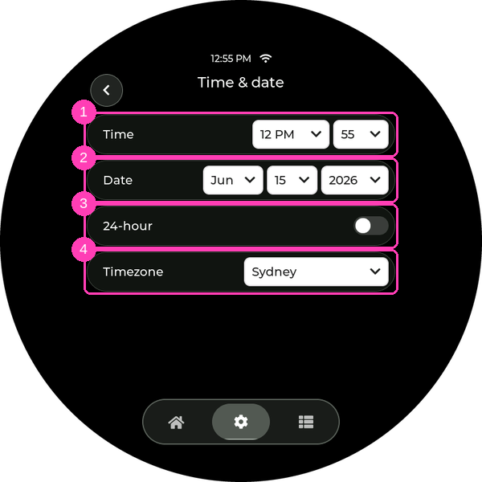

- ① **Time** — hour and minute pickers, to set the clock by hand. (With Wi‑Fi +
  NTP the clock sets itself on every boot.)
- ② **Date** — month / day / year pickers. NTP fills the date in automatically;
  without NTP a real date is needed for features that stamp records (shot
  history). Setting only the time leaves the date unset.
- ③ **24‑hour** *(default on)* — clock format.
- ④ **Timezone** — city picker (handles daylight saving). Governs how all
  times display and how NTP time is converted.

Once **Auto time** (on the WiFi page) has set the clock, the **Time** and
**Date** rows give way to a line saying so — the next sync would overwrite
anything picked by hand. To set them yourself, turn Auto time off. Until the
first sync (no WiFi, or no internet), the pickers stay, so a date for shot
history is always reachable.

### WiFi

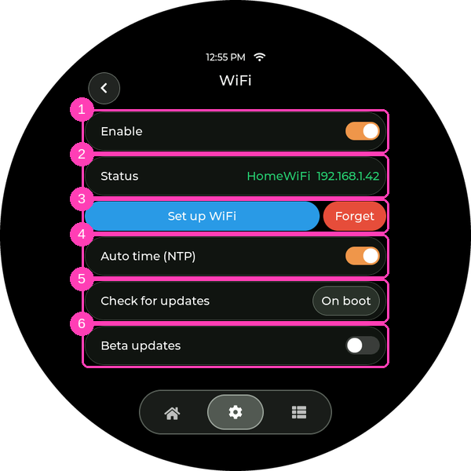

- ① **Enable** *(default off)* — join your home network. Used for the clock,
  update checks and the History web page; all machine/scale control is local
  Bluetooth.
- ② **Status** — `Off`, `Connecting`, `Connection failed`, or — once
  connected — the network name and IP address in green.
- ③ **Set up WiFi** — starts the device's own access point (`Micra-Setup`) and
  setup page for entering credentials (same flow as token entry: scan the
  QR code on the screen with your phone's camera and the page pops up on its
  own, or join the network and open the shown address):

  <p align="center">
    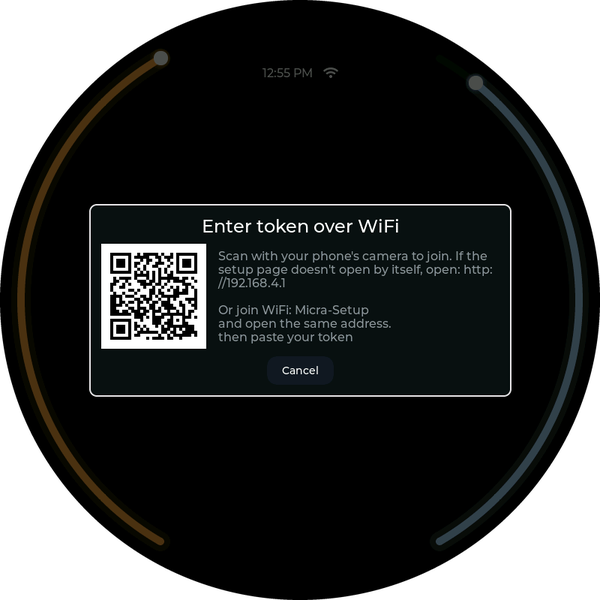
  </p>

- ③ **Forget** — clears the saved network.
- ④ **Auto time (NTP)** *(default on)* — sync the clock over WiFi while
  connected. (The timezone it applies is set under **Time & date**.)
- ⑤ **Check for updates** *(default On boot)* — tap to cycle **Off / On boot /
  Daily / Hourly**. "On boot" checks once at startup; "Daily" and "Hourly" also
  re-check on that interval while the machine stays on — always during an idle
  moment (the idle screen is up), so they never get in the way. If Screen
  timeout is Off, the repeating checks never fire; the startup check and the
  manual button still work. Checks only run after an NTP sync has proven the
  internet is reachable. When a newer firmware exists, a notice shows the
  version and its release notes:

  <p align="center">
    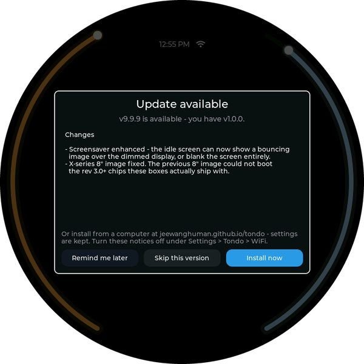
  </p>

  **Install now** installs it right on the device (see below); **Remind me
  later** closes the notice and offers again on the next check; **Skip this
  version** never offers that version again (the next release will). You can
  also check any time from **Stats → Info → Check** — and if it can't reach
  the server it says "Couldn't check" rather than "up to date".

  **Installing** — after **Install now**, Tondo restarts into a minimal update
  screen: a progress bar while it downloads the new firmware, then a short
  **"screen goes dark for about 20 seconds — don't power off"** phase while it
  writes, then it restarts on the new version. Your settings, the paired
  machine, and shot history are kept, and a firmware that fails to boot rolls
  back to the old one automatically. The
  [web flasher](https://jeewanghuman.github.io/tondo/) remains the
  fallback for recovery and for the very first flash.

- ⑥ **Beta updates** *(default off; shown only while checks are on)* — also
  offer pre-release builds, named like `0.15.0-beta.1`. Betas ship the next
  release early so it can be tested on real machines; they are less proven than
  a normal release, and the notice, the install and the automatic roll-back on
  a firmware that won't boot all work exactly the same.

  Switching the toggle re-checks straight away, so the next notice matches the
  channel you picked. Turning it **off** while running a beta does not move you
  back on its own — the device stays on that build until a stable release is
  newer than it (`0.15.0` supersedes `0.15.0-beta.2`), which is usually days.
  To go back sooner, reflash the stable release from the
  [web flasher](https://jeewanghuman.github.io/tondo/); your settings
  and history are kept.

### Backup

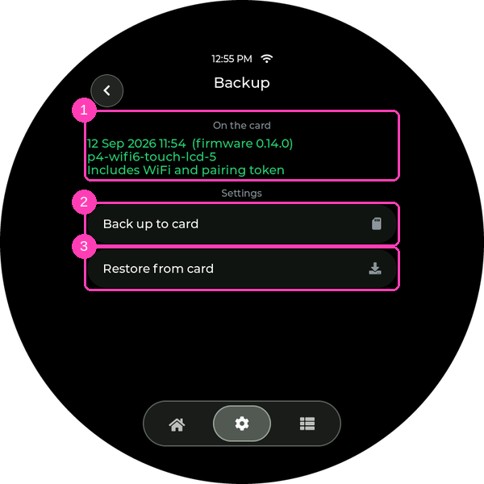

Your settings live inside Tondo, not on the memory card — so moving the card
to another one brings every shot across and none of your preferences. This page
copies the settings onto that same card, so a replacement can pick them up.

- ① **On the card** — what the inserted card holds: when the backup was taken,
  the firmware and board it was taken on, and whether it carries your WiFi
  network and pairing token. Otherwise `No card inserted` or `No settings
  backup on this card`.
- ② **Back up to card** — writes every setting to `/Tondo/settings.txt`,
  beside your shots. It is plain text, readable on any computer:

  <p align="center">
    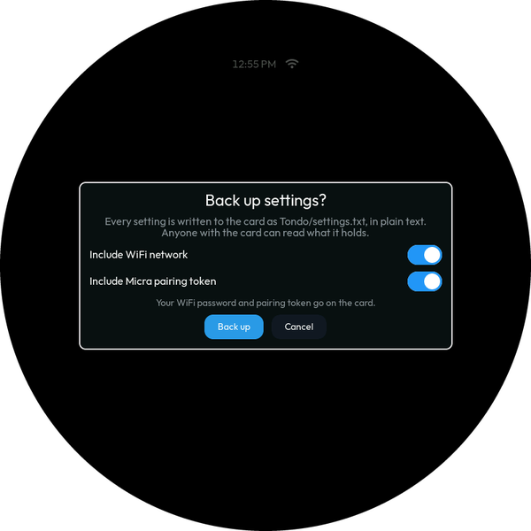
  </p>

  The two switches decide whether your **WiFi network** (name and password) and
  your **Micra pairing token** go onto the card with everything else. Both are
  on by default — the point of a backup is a replacement that just works — and
  turning one off means setting that up by hand later, which is the trade worth
  making if the card won't stay with the machine. Everything else (chime,
  target weight, flush settings, timezone, and the rest) always travels.
- ③ **Restore from card** — replaces every setting on this Tondo with the
  backup, then restarts to apply it. Anything the backup doesn't carry — a
  setting added in a later firmware, or a credential you left out — goes back
  to its default. Greyed out when the card holds no backup.

A few things worth knowing:

- **Moving between devices is the point.** A backup taken on one Tondo
  restores onto another, and so does one taken on Apollo 2 (the firmware Tondo
  grew from); nothing in it is board-specific. Apollo 2 can't read Tondo's
  backups.
- **A backup from newer firmware is refused** — update this Tondo first, then
  restore. Older backups are always fine.
- **Nothing happens on its own.** No automatic backup, no automatic restore;
  swapping cards between machines never changes a setting by itself.
- **Your shots aren't part of this** — they are already on the card, and a
  restore doesn't touch them.

### Root page

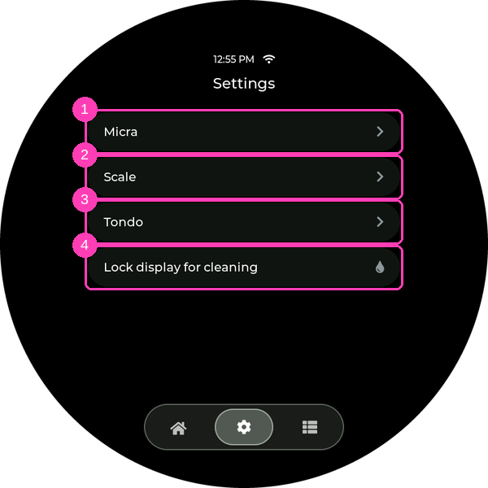

The rows ①–③ open the **Micra**, **Scale**, and **Tondo** pages above; one
action lives directly on the root:

- ④ **Lock display for cleaning** — disables touch for 30 seconds so you can
  wipe the screen. A full‑screen countdown shows the time remaining; the lock
  ends on its own (touching the screen does nothing until then).

  <p align="center">
    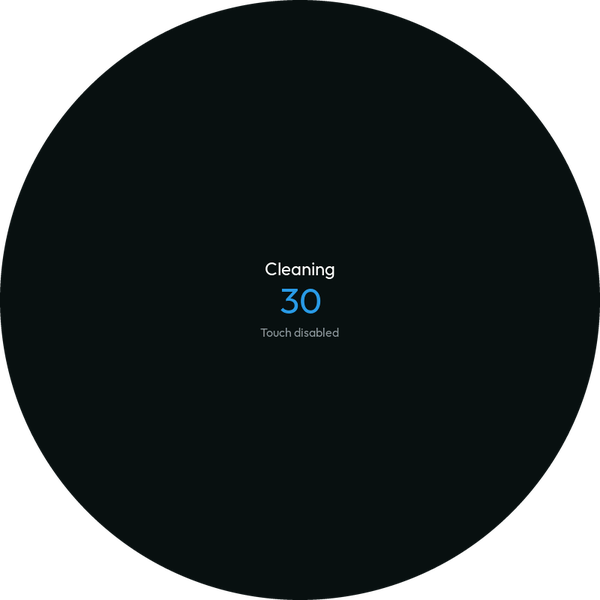
  </p>

---

<a id="stats-section"></a>

## Stats

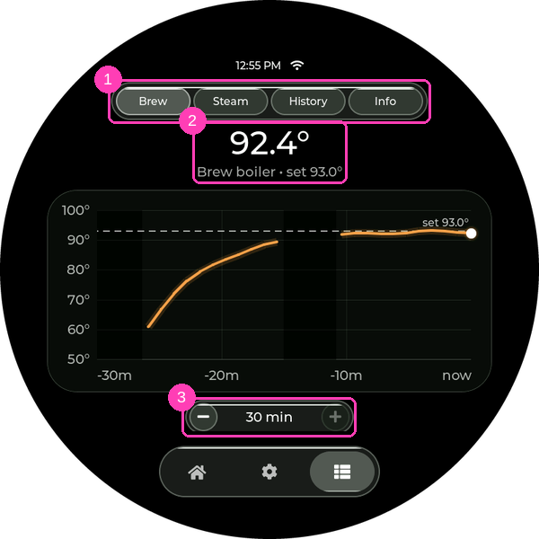

- **Brew / Steam** — temperature history, chosen with the selector ①. Above
  the chart ② sits the boiler's latest reading and its set‑point. The chart
  itself runs left to right in time (`now` at the right) with temperature up
  the side; its scale zooms to the readings, so a settled boiler's small
  wobble shows instead of a flat line. The set‑point is the dashed line,
  shaded gaps are times the machine was disconnected, and the bright dot is
  the newest reading. **− / +** ③ change the time window (30 minutes up to
  24 hours).

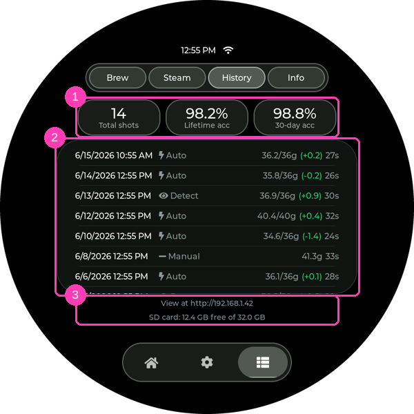

- **History** — the shot log (needs a microSD card). Headline bubbles ① show
  lifetime totals: shots recorded, lifetime accuracy and 30‑day accuracy
  (actual vs target weight). Below, the shot list ②, newest first; the
  footer ③ shows the web address and SD‑card space. Each row shows the signed
  miss against target — `36.2/36g (+0.2)` — green within 2 g, amber beyond,
  and how the shot was run: a bolt for an **Auto** shot (the paddle harness
  stopped it at weight) or an eye for a **Detect**ed one (inferred from the
  scale). Only those two modes record — a fully manual shot has no armed
  start/stop, so nothing is saved. Tap a shot for a full‑screen card with its
  result/target/diff, time, average flow, and the weight + flow graph:

  <p align="center">
    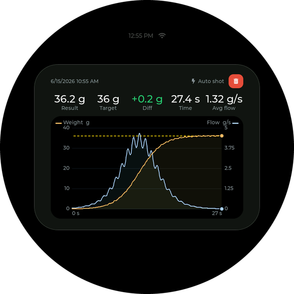
  </p>

  - **SD card**: any size — a **small card is more than enough**. A shot is
    a few tens of KB, so even a 1 GB card holds decades of daily espresso;
    an old card from a drawer is perfect. Use a card formatted **FAT32**
    (FAT16 also works) — small cards usually ship that way. exFAT — the
    factory format of most cards over 32 GB — and NTFS are **not**
    supported: History detects what's on an unusable card and names it
    ("This SD card is exFAT‑formatted…") instead of pretending the slot is
    empty. Reformat on a computer; the device never formats or erases a card
    on its own.
  - **Hot‑swap friendly**: no reboot needed in either direction. The device
    looks for a card every 5 seconds, so a freshly inserted card is picked
    up within ~5 s; a removed card is likewise noticed within a few seconds
    and History switches back to the insert‑a‑card guidance. If the card
    fills up, new shots stop being saved and History says so.
  - **What's recorded and when**: recorded shots are viewable immediately —
    no clock needed. Recording NEW shots additionally needs a real date/time
    (NTP, or Settings → Tondo) — until the clock is set the footer warns
    that shots aren't being saved. Records live on the card under `/Tondo`
    — an index CSV plus one samples CSV per shot — so the whole history can
    be read on any computer (graphs are drawn from the data by the device
    and the web page; nothing is pre‑rendered — the CSVs are the database).
    A card used with Apollo 2 keeps its history in `/Apollo2`: the first
    time Tondo reads the card it renames that folder to `/Tondo`, so the
    shots and any settings backup carry over.
  - **Delete a shot**: open its card and tap the red trash button, then
    confirm. The shot's files are removed from the card and the headline
    stats recalculate without it — handy for throwing out dial‑in or
    practice shots. This one *is* destructive (unlike Reset stats below).
  - **Reset stats**: tap any headline bubble. Non‑destructive — the three
    headline numbers restart from now (the Total bubble shows "Since ⟨date⟩")
    while every recorded shot stays on the card. Undo by deleting
    `Tondo/stats_since.txt` on a computer.
  - **Browse from your phone or computer**: with WiFi connected, open
    `http://⟨device IP⟩/` (the address is in the footer and on **Stats →
    Info**). The device serves its own web page — the same stats, with month
    filters, and the shot list, with a live graph per shot, a **Download
    card** button that saves any shot as a PNG image (composed in your
    browser from the raw data), and CSV downloads. The same built‑in web
    server also carries the setup pages during pairing/WiFi setup, so nothing
    conflicts.

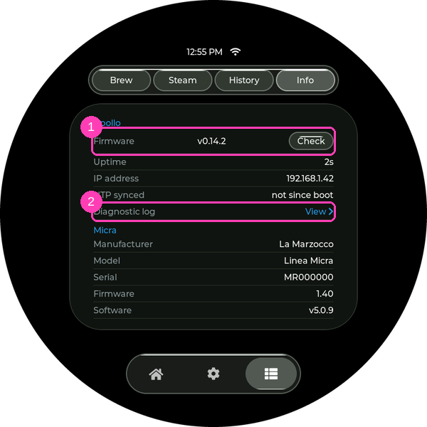

- **Info** — device details: our firmware version + git revision, uptime,
  **NTP synced** (how long ago the clock last synced over the internet, or
  "not since boot"), and the machine's Device Information (manufacturer,
  model, serial, firmware) read over Bluetooth.
  - ① **Firmware** — tap **Check** to check the releases site right now (needs
    WiFi + NTP). It reports back either an update notice or "You're on the
    latest firmware" — the same check the boot option runs, on demand.
    **Long‑press the row** to show or hide LVGL's live FPS / CPU readout, a
    developer aid (a short message confirms which); it stays as you left it
    across restarts.
  - ② **Diagnostic log** — tap **View** for the recent diagnostic log (the same
    messages the USB serial console prints), each line stamped with the time
    (or seconds‑since‑boot before the clock is set). The log lives in RAM:
    it survives as long as the device stays powered and holds the last
    64 KB — typically hours of normal operation — so "the paddle did nothing
    this morning" can be diagnosed after the fact without a serial cable.
    It does not survive a reboot. The on‑screen viewer shows the newest few
    KB; with WiFi connected, `http://⟨device IP⟩/log` serves the whole
    thing as plain text (there's also a **Log** link on the web page's
    header) — easy to copy into a bug report.
  - **Crash dumps** — if the firmware ever crashes and reboots, it saves a
    post‑mortem snapshot (a *coredump*) to internal flash first. On the next
    boot the log notes `crash dump stored`, and with WiFi connected a
    **Crash dump** link appears in the web page's header (next to **Log**;
    `http://⟨device IP⟩/coredump` directly also works) that downloads it as a
    file — attach it to a bug report and the exact cause can be pinpointed.
    The filename is a fingerprint of the build that *crashed* (dumps survive
    firmware upgrades, so that isn't always the version currently
    installed); it matches the `.appsha` files in the release's
    debug‑symbols archive, which is how the right decoding symbols are
    found. The dump survives reboots and even firmware
    upgrades until the next crash overwrites it;
    `http://⟨device IP⟩/coredump?erase=1` clears it manually.

---

<a id="bbw-reference"></a>

## Brew‑by‑weight quick reference

| | Auto shot | Shot detect | Manual |
|---|---|---|---|
| Needs paddle wiring | **Yes** | No | No |
| Shot start | Paddle flip | Detected from weight (back‑dated by **Detect lead‑in**) | Paddle flip (wired) / — |
| Shot stop | **Automatic** at target − learned overshoot | You flip the paddle (pill flashes **Stop** at the right moment) | You flip the paddle |
| Auto‑tare at start | Yes | No (delta‑based) | No |
| Overshoot learning | Yes | No | No |
| Review graph + frozen weight | Yes | Yes | No |
| Auto flush eligible | Yes | Yes (wired paddle) | No |

Wiring the paddle harness — parts, photos of the Micra's paddle loom, and
the 3.4C's header pins — is covered in the [wiring guide](docs/WIRING.md).

### Paddle pin protection & per‑unit remapping

- **Suggested: a 1 kΩ resistor in line with the paddle's sense wire** (at the
  screw terminal, between the board pin and the switch). It protects the
  input by limiting current from static or stray voltage on the wire —
  one cheap part, no effect on normal operation. The
  [wiring guide](docs/WIRING.md) shows a no‑solder way to add it with a
  4‑slot screw‑terminal block.
- **If a paddle pin ever does fail** (symptom: the paddle stops registering
  or behaves erratically while everything meters fine — the diagnostic log's
  `Paddle: raw sense ...` lines will show a line stuck or drifting on its
  own), the pins are **remappable per unit** without a custom firmware
  build: move the wire to a free GPIO on the header, connect the device over
  USB, and run

  ```
  make padsense PIN=50      # sense wire moved to GPIO50 (example)
  make paddrive PIN=49      # drive wire, same idea
  make padsense PIN=-1      # revert to the board default
  ```

  (or type `padsense=50` into any serial monitor). The setting is stored in
  the device's settings memory — it survives reflashes and web‑flasher
  upgrades, so stock releases keep working on a remapped unit — and takes
  effect on the next boot, which logs it: `Paddle: sense GPIO50 (NVS
  override)`. The board's default pins stay unchanged for everyone else.
