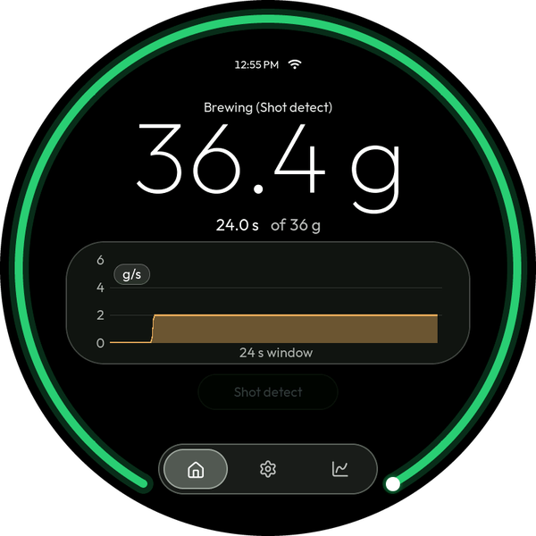
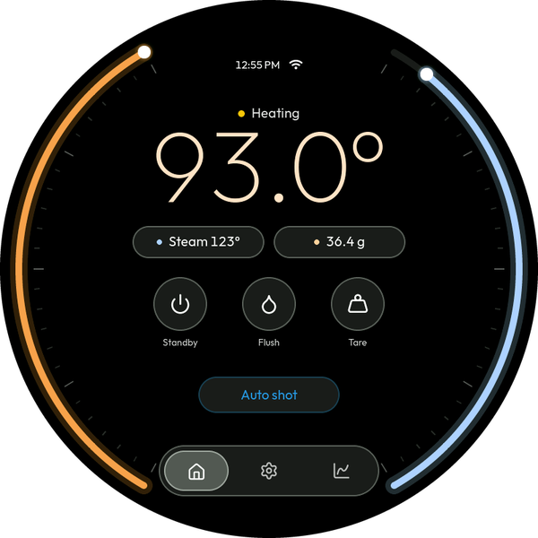
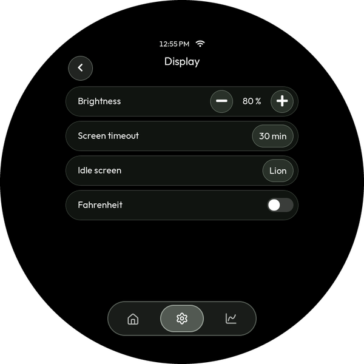
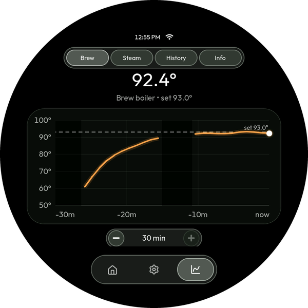

# Tondo

**Tondo** is firmware that turns Waveshare's **round 3.4" ESP32‑P4 touch
display** into a local controller for a **La Marzocco Micra** espresso
machine — over Bluetooth, with no cloud dependency for day‑to‑day use. (A
*tondo* is Italian for something round, and the name of the round paintings of
Renaissance Florence — La Marzocco's home town.)

Set your brew temperature on a dial, flip the steam boiler, put the machine on
standby, watch both boilers come up to temperature around the edge of the
glass, and (with a supported Bluetooth scale) run a live shot timer, flow graph
and brew‑by‑weight — all from a dedicated little screen next to the machine
instead of a phone app.

Tondo is a fork of **[Apollo 2](https://github.com/mlsorensen/Apollo2)** by
Marcus, adapted to the round
**[ESP32‑P4‑WIFI6‑Touch‑LCD‑3.4C](https://www.waveshare.com/esp32-p4-wifi6-touch-lcd-3.4c.htm)**
with an interface designed for the circle. Everything Apollo 2 does works
here; the screens are new.

<p align="center">
  
</p>

> The focus is on local control via Bluetooth. The internet is only used for
> optional time sync and firmware updates.

**Contents:**
[Features](#features) ·
[Getting started](#getting-started) ·
[Screenshots](#screenshots) ·
[Hardware](#supported-hardware) ·
[3D prints](#3d-prints) ·
[Developer documentation](#developer-documentation) ·
[Credits](#credits) ·
[License](#license)

---

## Features

- **Local Micra control over Bluetooth** — brew temperature on a dial, steam
  boiler on/off and level, standby, and live machine status. No cloud, no
  phone app.
- **Bluetooth scales** — Bookoo Themis, Acaia (Umbra, Lunar, Prochef, Pyxis)
  and Varia Aku: live weight, shot timer, flow graph, tare, and the scale's
  own settings from the screen.
- **Brew by weight** — stop the shot at a target weight with the paddle wired
  in, or detect shots from the weight stream alone with no wiring at all.
  Finished shots freeze into a review graph.
- **Group care** — auto‑flush after the cup lifts, flush on demand, and a
  backflush cleaning cycle, with the paddle wired in.
- **Warm‑up chime** — the built‑in speaker plays a tune when the machine is
  ready, so you can start it and walk away.
- **Shot history** — every shot is saved to a microSD card as CSV, browsable on
  the device's Stats tab or from a phone via the device's own web page.
- **Settings backup** — preferences copy to the same card and restore onto
  replacement hardware.
- **Over‑the‑air updates** — the device checks this fork's releases for new
  firmware and installs it on request, with an optional beta channel.
- **Setup from your phone, no app** — pairing and Wi‑Fi credentials go in
  through a page the device serves itself; scan the QR code on its screen.
- **Automatic time** — NTP over your Wi‑Fi with a timezone picker.
- **Made for the round glass** — a glass‑style interface laid out for the
  circle, °C/°F, 12/24‑hour clock, brightness, and idle screens including a
  round clock face.

Everything keeps working if the machine, the scale, or Wi‑Fi is absent — the
UI just shows that part as offline.

---

## Getting started

> [!IMPORTANT]
> **Before buying any hardware, confirm you can get your machine's Bluetooth
> token.** Tondo authenticates to the Micra with a token issued by the La
> Marzocco cloud. Grab it first with the **[LM Token](tools/lmtoken/)** app — sign
> in with your La Marzocco account and copy the token. If it comes back blank, the
> same tool can provision one over Bluetooth. Checking now avoids a nasty surprise
> after a board is already on your bench.

### 1. Get the hardware

The firmware runs on one board: the
**[Waveshare ESP32‑P4‑WIFI6‑Touch‑LCD‑3.4C](https://www.waveshare.com/esp32-p4-wifi6-touch-lcd-3.4c.htm)**
(see [Hardware](#supported-hardware) below). Add a USB‑C power supply and,
for shot history, a small microSD card. A Bluetooth scale is optional but
unlocks the shot timer, flow graph, and brew‑by‑weight. Wiring the machine's
paddle (for Auto shot) is optional too, and can always be added later — see
the [wiring guide](docs/WIRING.md).

### 2. Flash the firmware

**No-toolchain option:** the [web flasher](https://jeewanghuman.github.io/Tondo/)
flashes the board straight from Chrome, Edge, or Firefox over USB — click
Install. Upgrading this way keeps your paired machine, Wi‑Fi and settings
(unless you choose "Erase device"). Prebuilt images also live on the
[Releases](https://github.com/jeewanghuman/Tondo/releases) page — those
are full images, so flashing one with `esptool` *does* clear saved settings.

After the first flash Tondo updates itself over WiFi: it checks for new
firmware, shows what changed, and installs on a tap. Tick **Include
pre-releases** on the flasher (or turn on **Settings → Tondo → WiFi → Beta
updates** on the device) to run beta builds instead — testing welcome, and a
build that won't boot rolls back on its own.

Building from source requires [PlatformIO](https://platformio.org/) (`pio`) and
a USB cable.

```sh
make flash-p4-3-4c    # build + flash the 3.4C
make monitor          # open the serial console (115200 baud)
```

The published image is for boards whose ESP32‑P4 is the **rev v1.x** chip
(the one this port was developed on). Waveshare is moving its P4 boards to a
newer rev v3 chip, which needs a different image: build it with
`make flash-p4-3-4c-rev3` — there's no published rev v3 image yet. Not sure
which you have? `esptool chip-id` prints it. A wrong image won't damage
anything — the screen just stays dark until the right one is flashed.

<a id="2-pair-the-machine"></a>

### 3. Pair the machine

**Settings → Micra → Bluetooth → Scan**, then pick your machine. The device saves
it, then asks for the machine's **Bluetooth token** (step 4) — the token is issued
by the La Marzocco cloud and can't be read off the machine, so there's a short
one‑time step to fetch it.

<a id="3-enter-your-token"></a>

### 4. Enter your token

Tap **Enter token** on the prompt (or **Settings → Micra → Bluetooth → Setup**)
to start the device's own Wi‑Fi access point, **`Micra-Setup`**. Scan the QR
code on the device's screen with your phone's camera — it joins the access
point and the setup page pops up on its own. (Or join `Micra-Setup` manually and
open **http://192.168.4.1**.) Paste your token and Save — the device connects
and the access point closes on its own.

Where to get the token:

- Download the **LM Token** app for your OS from the upstream project's
  [Releases](https://github.com/mlsorensen/Apollo2/releases) page, unzip, and
  double-click it. Sign in with your La Marzocco account, pick your machine, and
  hit **Copy token**. This is the only step that uses the internet, and it runs
  on your computer. (Prefer a terminal? The `lmtoken` CLI is on the same page.)

> Prefer to build **LM Token** / `lmtoken` from source (Go), or script it? See
> [`tools/lmtoken/README.md`](tools/lmtoken/README.md).

### 5. (Optional) Wi‑Fi + automatic time

On the same setup page you can enter your home Wi‑Fi name and password. The
device then joins your network, gets an IP, and syncs the clock over NTP. Pick
your city under **Settings → Tondo → Time & date → Timezone**. Auto‑sync can be
turned off under **Settings → Tondo → WiFi → Auto time (NTP)**.

Because the setup page is always reachable from **Set up WiFi**, you can never be
locked out if your network changes.

### 6. Find your way around

The three buttons at the bottom of the circle switch between the tabs:

- **Home** shows the machine: status, the brew temperature (tap it for a dial
  to change the set‑point), the steam boiler (tap it for on/off and the steam
  levels), and **Standby** / **Flush**. With a scale paired it adds the weight,
  **Tare** and the shot‑mode pill — **Auto shot** (wired paddle) / **Shot
  detect** / **Manual** — and switches to a shot view with a progress ring and
  flow graph while a shot runs.
- **Settings** groups everything under Micra, Scale, and Tondo (display,
  sound, time, Wi‑Fi, backup).
- **Stats** shows brew and steam temperature history, the shot **History**
  log, and device info.

Every screen and setting is described in the **[user manual](MANUAL.md)** —
it opens with a **map of every screen and setting** if you're looking for
where something lives.

---

## Screenshots

<p align="center">
  
  
</p>
<p align="center">
  
  
</p>

<!-- These come from the simulator's renders via `make docs-img` — see "The
     simulator" under Developer documentation for the refresh convention. -->

---

<a id="supported-hardware"></a>

## Hardware

| | |
|---|---|
| **Board** | [Waveshare ESP32‑P4‑WIFI6‑Touch‑LCD‑3.4C](https://www.waveshare.com/esp32-p4-wifi6-touch-lcd-3.4c.htm) ([wiki](https://www.waveshare.com/wiki/ESP32-P4-WIFI6-Touch-LCD-3.4C)) |
| **Screen** | 3.4" round, 800×800, capacitive touch |
| **Inside** | ESP32‑P4 (32 MB flash, 32 MB PSRAM); Wi‑Fi 6 + Bluetooth LE via an on‑board ESP32‑C6 |
| **Also used** | speaker (warm‑up chime, button clicks), microSD slot (shot history, settings backup), 40‑pin header (paddle wiring) |
| **Power** | USB‑C. There's no battery circuit on this board. |
| **Enclosure** | [3D‑printed round case](#3d-prints) — the board has none |
| **Auto‑shot wiring** *(optional)* | DIY cable with an external opto module — see the [wiring guide](docs/WIRING.md) |

The 3.4C is the same electronics as Waveshare's rectangular
ESP32‑P4‑WIFI6‑Touch‑LCD‑4.3 — the board upstream Apollo 2 supports — behind
round glass. Power, clock and pin details live in
**[docs/HARDWARE.md](docs/HARDWARE.md)**.

<a id="3d-prints"></a>

### 3D‑printed case and mounts

Print files live in [`hardware/3d-prints/`](hardware/3d-prints/):

| File | What it is |
|------|------------|
| [`esp32-p4-3.4c-shell.scad`](hardware/3d-prints/esp32-p4-3.4c-shell.scad) | The round **case** for the 3.4C, as an editable [OpenSCAD](https://openscad.org/) model: a cup the board drops into from behind, and a back cover held by 4 screws. The cover has the same two mounting holes as Apollo 2's stand and magnet mount, so they fit it unchanged. |
| [`esp32-p4-3.4c-shell.3mf`](hardware/3d-prints/esp32-p4-3.4c-shell.3mf) | The case exported ready to print. |
| [`esp32-p4-3.4c-fit-gauge.3mf`](hardware/3d-prints/esp32-p4-3.4c-fit-gauge.3mf) | A 4 mm slice of the case front — print it first (about 10 minutes) to check how the glass fits. |
| [`tondo-stand.3mf`](hardware/3d-prints/tondo-stand.3mf) | Counter‑top **stand** (designed for Apollo 2). |
| [`tondo-magnet-mount.3mf`](hardware/3d-prints/tondo-magnet-mount.3mf) | Optional **magnet mount** (designed for Apollo 2) — attaches the display to the Micra's top corner instead of the counter. |
| [`tondo-wiring-gasket.3mf`](hardware/3d-prints/tondo-wiring-gasket.3mf) | Optional **wiring gasket** (designed for Apollo 2) — spaces the Micra's cover so the wiring can run underneath it. |

> [!NOTE]
> **Measure before you print the case.** Waveshare publishes only the board's
> 115 mm outline, so the case's depth and the position of the USB‑C opening are
> estimates. They're the values marked `MEASURE` at the top of the `.scad` file:
> check them against your board, print the fit gauge, adjust, and export
> (`openscad -D 'part="shell"' -o shell.stl esp32-p4-3.4c-shell.scad`, and the
> same with `"cover"`).

This [short video](https://youtube.com/shorts/Ea0IaJ7hjvQ) shows how the
magnet mount and wiring gasket fit together on the machine (it shows upstream's
rectangular display; the mount is the same).

Fasteners:

- **Case**: 4 × **M2.5×6 mm** screws through the side of the case into the
  back cover.
- **Stand or magnet mount**: 2 × **M4‑0.7×8 mm** screws into the back cover.
- **Magnet mount**: 8 × **10 mm × 3 mm** neodymium disc magnets.

---

## Developer documentation

### Architecture

The code is layered so the same UI runs on a real board and on a laptop:

```
include/core/        Pure interfaces (ports) + domain types. No LVGL, Arduino,
                     BLE, or SDL — just C++ and structs. e.g. IMachine, IScale,
                     IClock, INetwork, IProvisioner, IBrewController, IShotStore
                     (SD shot history), and the BLE central port (ble::ICentral).

src/core/            Portable protocol logic: the La Marzocco Micra link and
                     the Bookoo scale driver, written only against ble::ICentral
                     — so a new platform (Linux/BlueZ, Pico/btstack) reuses the
                     Bluetooth protocol code unchanged and implements only the
                     transport. Also the device-independent decisions: which
                     event makes which sound (sound.cpp), when a warm-up counts
                     as finished (ready_chime.h).

src/ui/              The LVGL user interface. Depends ONLY on core/ interfaces,
                     never on a concrete platform. Portable. The round screens
                     live beside the rectangular ones (round_home.cpp, glass.cpp,
                     and round branches in the other tabs).

src/platform_esp32/  Device implementations of the core ports: the NimBLE GATT
                     transport, NVS config, display/touch drivers, Wi-Fi
                     station + NTP, the setup-portal web server.

src/platform_host/   "Fake" implementations that feed canned data, so the UI can
                     be built and rendered on a host with no hardware.

src/device/main.cpp  Device entry: wires the real implementations to ui::App.
src/sim/main.cpp     Simulator entry: wires the fakes, renders frames to PNG.
```

The UI is written against the `core::` ports and is injected with concrete
implementations at startup (`App::build(...)`). Swapping the real BLE machine for
a `FakeMachine` is all that separates a board build from a laptop render — the UI
code is byte‑for‑byte identical.

### The simulator

No hardware needed. Builds a native executable that renders each screen/layout
to `renders/*.png`:

```sh
make sim              # build + run, writes renders/*.png
```

This is the fastest way to iterate on UI: change code, `make sim`, look at the
PNGs. The round screens are the `renders/round_*_800x800.png` files: they're
masked to the circle (the glass edge drawn in red, everything off the glass
dimmed) so anything the panel would hide stands out. A clean copy of each goes
to `renders/glass/`.

The `renders/` folder is git‑ignored build output; the screenshots in
`docs/img/` and the annotated manual images in `docs/img/manual/` are generated
from the clean round renders by `make docs-img` (`tools/annotate_docs.py` + its
manifest). **When the UI changes, run `make sim` and `make docs-img` as part of
the same change** so the README and manual stay accurate.

### Prerequisites

**PlatformIO** (`pip install platformio`) builds everything, and **node** (any
recent LTS — `brew install node`) builds the shot-history web page the device
serves. That page is embedded in the firmware as a generated header,
`include/platform_esp32/webapp_dist.h`, which is **not committed**: every
`make build`/`make flash` target rebuilds it when anything under
[`tools/webapp/`](tools/webapp) changes, and the release workflow does the same,
so a board can never serve a page that has drifted from the source. `make sim`
needs no node — the simulator has no web server.

### Building directly

`pio run` does *not* generate the web-app header (that dependency lives in the
Makefile), so run `make webapp` first — or just use the `make` targets, which
handle it.

```sh
pio run -e esp32-p4-micra-3-4c        # the round 3.4C, rev v1.x chip (the published image)
pio run -e esp32-p4-micra-3-4c-rev3   # the same board with a rev v3 chip
pio run -e sim                        # native simulator
```

`platformio.ini` also carries upstream's boards (the rectangular P4 and S3
displays). They still build — `make build-all` compiles every env — but this
fork publishes only the 3.4C image; `make build-release` compiles that and the
simulator.

Build environments and per‑board flags live in
[`platformio.ini`](platformio.ini); the pin/panel definitions for each board are
in [`include/platform_esp32/board_config.h`](include/platform_esp32/board_config.h).

### Releases

Releases are tagged `vX.Y.Z`; a `vX.Y.Z-beta.N` tag publishes the image as a
pre-release, listed only in `releases-beta.json` (the stable `releases.json`
every device reads stays releases-only) — promoting one to stable is a rebuild
at the real tag, never a copy of the artifacts, because `fw::kVersion` is
compiled into the image. The release workflow (`firmware-release.yml`) builds
the 3.4C image, and the self‑updater fetches
`<site>/<tag>/firmware/app/<slug>.bin` from this fork's GitHub Pages site.
Publishing is gated: the workflow builds unattended, but the jobs that create
the Release and push `gh-pages` (the update origin) run in a protected
environment that holds the only write credential and waits for the owner's
approval.

### Repository layout

```
include/core/          Domain interfaces + types
src/core/              Portable protocol implementations (Micra BLE, scales,
                       audio cues)
include/platform_esp32/ Device driver headers + board_config.h
include/platform_host/  Host fakes
include/ui/             UI headers (widgets, screen profiles, timezones)
include/vendor/         Vendored third-party headers (stb_image_write)
src/                    Implementations (see Architecture above)
hardware/3d-prints/     The round case (OpenSCAD + 3MF), stand and mounts
tools/                  sim.sh, flash.sh, lmtoken (Go), annotate_docs.py,
                        PlatformIO helper scripts
renders/                Simulator output (PNG)
```

---

<a id="credits"></a>

## Credits & third‑party

This project stands on the work of others. Grateful thanks to:

- **[Apollo 2](https://github.com/mlsorensen/Apollo2)** by Marcus (MIT) — the
  firmware this fork is built on: the Micra and scale protocols, brew‑by‑weight,
  shot history, updates, and the rest.
- **[pylamarzocco](https://github.com/zweckj/pylamarzocco)** by Josef Zweck
  (MIT) — the reference for La Marzocco's Bluetooth protocol (GATT
  characteristic UUIDs, the JSON command/state payloads, machine name prefix) and
  the cloud auth flow that `tools/lmtoken` re‑implements in Go.
- **[goscale](https://github.com/mlsorensen/goscale)** (Apache‑2.0) — the model
  for the scale interface and the Bookoo Themis notification decode.
- **[apollo](https://github.com/mlsorensen/apollo)** — brew‑by‑weight /
  paddle‑stop approach that inspires the brew controller.
- **Waveshare** — board bring‑up details, panel init tables and pin maps from
  their published demos and schematics.
- **[Outfit](https://fonts.google.com/specimen/Outfit)** (SIL Open Font
  License 1.1, see `src/ui/fonts/OFL-Outfit.txt`) — the round display's
  typeface, from the large numerals to the smallest label.
- **[Lucide](https://lucide.dev)** (ISC, with icons derived from Feather under
  MIT — see `src/ui/fonts/LICENSE-Lucide.txt`) — the thin-line icons on Home,
  in the tab bar and on the temperature dial.
- **[stb_image_write](https://github.com/nothings/stb)** by Sean Barrett (public
  domain / MIT) — vendored in `include/vendor/` for PNG output in the simulator;
  its license is retained in the file.

Library dependencies (fetched by PlatformIO): **LVGL** (MIT), **esp‑nimble‑cpp**
(Apache‑2.0), **Arduino‑ESP32** (LGPL‑2.1 / Apache‑2.0), **GFX Library for
Arduino** (BSD‑style), and **ArduinoJson** (MIT). Each retains its own license.

---

## License

[MIT](LICENSE) © 2026 Marcus.

Not affiliated with or endorsed by La Marzocco or Waveshare. "La Marzocco" and
"Micra" are trademarks of their respective owner; used here only to describe
compatibility.
