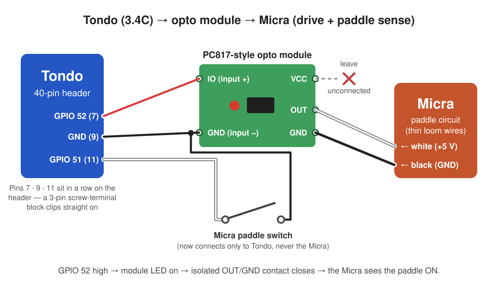

# Wiring the paddle (Auto shot)

This is the **optional** hardware step that unlocks **Auto shot** (the
firmware stops the shot at your target weight) and **auto‑flush**. Tondo sits
*in the middle* of the Micra's paddle circuit: the physical paddle switch now
feeds Tondo's sense input, and Tondo's isolated output stands in for the
paddle on the Micra's controller. Nothing else about the machine changes, and
**Shot detect** works fine without any of this.

The paddle circuit itself is low‑voltage (the Micra's controller puts ~5 V on
it), but you will have the machine open — **unplug the Micra first**.

> **Disclaimer:** this is a DIY modification. Done properly it is safe and
> fully reversible, but it is not endorsed by La Marzocco and you do it
> entirely at your own risk.

> **Note:** while this wiring is in place, the paddle works **only through
> Tondo** — with the controller off, unplugged, or missing, flipping the
> paddle does nothing. Because the tap is made with pluggable connectors,
> undoing it is easy: open the top and temporarily reconnect the paddle's
> original connectors to run the machine without Tondo.

## Parts

- A **3‑conductor cable** to run between Tondo and the machine — for example
  [this one](https://a.co/d/07cSW1AY), but any 3‑conductor cable works.
- **Bullet connectors** (or your favorite splice) for the in‑machine pigtail,
  so everything stays pluggable and reversible.
- A single‑channel **PC817‑style opto‑isolator module**, e.g.
  [this one](https://a.co/d/03qHqcyM) — anything similar works. It keeps
  Tondo electrically separate from the machine's controller.
- A [2.54 mm screw‑terminal block](https://a.co/d/0eVdsD4h) that clips onto
  the board's 40‑pin header makes the board‑side connection clean and
  solder‑free.

Although there are **four** connections at the machine end (Micra white,
Micra black, and the two paddle‑switch wires), one 3‑conductor cable is all
you need — **ground is shared**. It just means the ground conductor gets
**two connectors** at the machine end.

## Inside the Micra

Remove the Micra's top panel. Toward the front you'll find a **black loom**
carrying a thin **white** and a thin **black** wire, ending in connectors that
join the paddle switch:

Two connectors can be temporarily unplugged for easier access to the loom
(arrows):

Prepare your cable with bullet connectors, run it into the machine, unplug the
paddle connectors, and wire Tondo in the middle as described below. What
you're looking at:

- The **thin wires** go to the Micra's controller: **white = +5 V**,
  **black = ground**.
- The **thicker wires** go to the physical paddle switch. The paddle
  connectors have no polarity — either direction works.

## At the board: the 3.4C's header

The paddle uses three pins that sit **side by side** in one row of the
board's 40‑pin header. The board prints each pin's GPIO number beside it, and
these three are printed **20, 21 and GND** — in the row whose labels end
"… 28 **20 21 GND** 29 SCL SDA 3V3". A
[2.54 mm 3‑pin screw‑terminal block](https://a.co/d/0eVdsD4h) clips straight
onto them, no soldering.

> [!CAUTION]
> These positions come from Waveshare's schematic and the board's printed
> labels, which agree, but they haven't been tried with a paddle on a real
> 3.4C yet. Before clipping anything on, read the labels on your board and
> check that the pin printed GND has continuity to the USB‑C shell.

The photos below are of upstream's 5" P4 board, whose header has its three
paddle pins (GND, 52, 51) at its corner instead; they show the idea:

The cable leaves the round case through the slot at its bottom edge. From
there, the opto module provides the isolation:

In detail:

- **Drive (Tondo → Micra):** Tondo **GPIO 21** → opto module input **IO**,
  and Tondo **GND** → the module's input **GND**. On the output side leave
  **VCC unconnected** ("VCC suspended") so OUT/GND form an isolated dry
  contact: module **OUT** → Micra **white**, module output **GND** → Micra
  **black**. When Tondo raises GPIO 21, the contact closes — exactly like the
  paddle.
- **Sense (paddle → Tondo):** one paddle‑switch wire → Tondo **GPIO 20**,
  the other → Tondo **GND**. The physical paddle now touches only Tondo,
  never the Micra. Suggested: a 1 kΩ resistor in line with this wire at the
  terminal block — it protects the input by limiting current from static or
  stray voltage on the wire, and has no effect on normal operation.
- **If a pin ever fails anyway**, both paddle pins can be remapped per unit
  (no custom build): move the wire to a free header GPIO and run
  `make padsense PIN=<n>` / `make paddrive PIN=<n>` with the board on USB —
  see the manual's "Paddle pin protection & per‑unit remapping" section.

**No‑solder way to add that resistor:** use a **4‑slot** screw‑terminal block
instead of the 3‑slot, with its extra slot over the pin printed **28**, so the
four positions sit on 28 / 20 / 21 / GND. **Bend or cut off position 1's
header pin** (the one over 28) so it doesn't insert into the board. Screw the
**1 kΩ resistor** in as a jumper between positions 1 and 2, then land the
paddle‑sense wire in position **1** instead of 2: the signal reaches GPIO 20
only through the resistor, and nothing was soldered or spliced. (The photo is
upstream's 5" board, where the spare slot sits at the other end.)

A finished cable (upstream's P4 build) with the opto module spliced in near
the machine end
(shown before wrapping the module in heat‑shrink — do wrap it, so nothing can
short out inside the machine). Of the cable's conductors, **red + black feed
the opto module's input** — that pair carries Tondo's drive and becomes the
Micra's paddle signal on the isolated side — while **white + the second
black** run to the physical paddle switch:

**Keep the opto module away from heat when installing it.** An opto‑isolator
loses transfer ratio as it warms, so one that heat‑soaks can stop registering
"paddle on" until it cools — a failure that looks exactly like a broken cable
and then fixes itself. Inside the machine is fine; sitting against the brew
head, a boiler, or any other heat‑producing surface is not. **Mount it low
and away from the brew head** — there is open space below the hot‑water pipe
and the steam wand that works well — and where clearance is tight, a piece of
neoprene sheet between the module and the nearest hot surface does the job.

## Bench‑test before installing

The whole cable can be validated before it ever touches the machine. Connect
it to Tondo, power up, and turn on **Settings → Micra → Controls → Wired
paddle**. Tondo relays the paddle regardless of anything else, so:

1. **Touch the two paddle‑sense wires together** — to Tondo that's the
   paddle flipping ON. The opto module's **red LED lights** while they're
   touching.
2. **Meter the Micra side**: with a multimeter in continuity mode across the
   two machine‑side connectors (the ones destined for the Micra's white and
   black), you should read a **closed circuit** while the sense wires touch
   and **open** when you separate them.

That's the whole contract — paddle closed ⇒ Micra‑side contact closed — so if
both steps behave, the install will work.

## Closing up

Tuck the finished wiring down into the machine, **reconnect any connectors
you unplugged** for loom access, and put the top panel back on.

## Afterwards

With **Wired paddle** on (from the bench test above), the **Auto shot** mode
appears on the Home shot pill, the **Flush** button appears on Home, and
**Auto flush** becomes available. See the
[manual](../MANUAL.md) for what each mode does.
